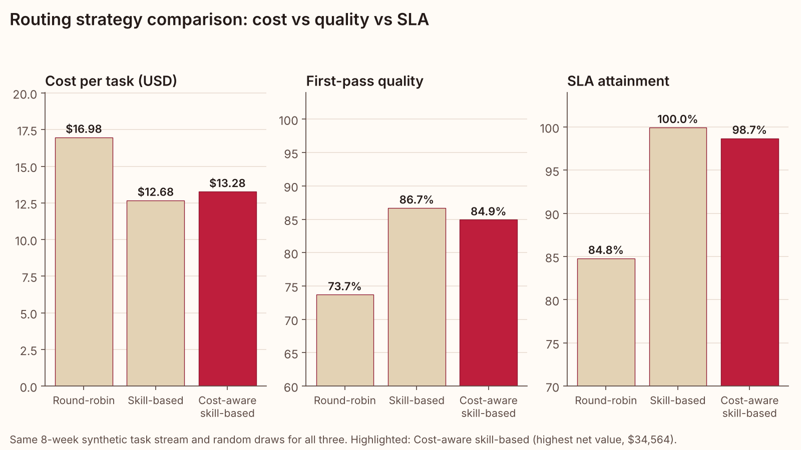
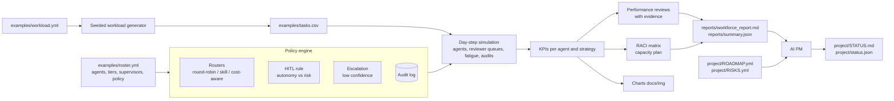
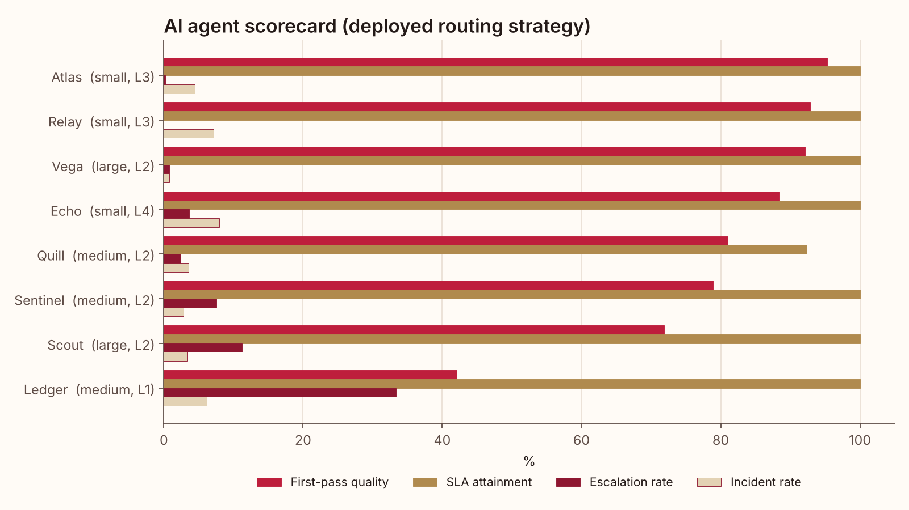
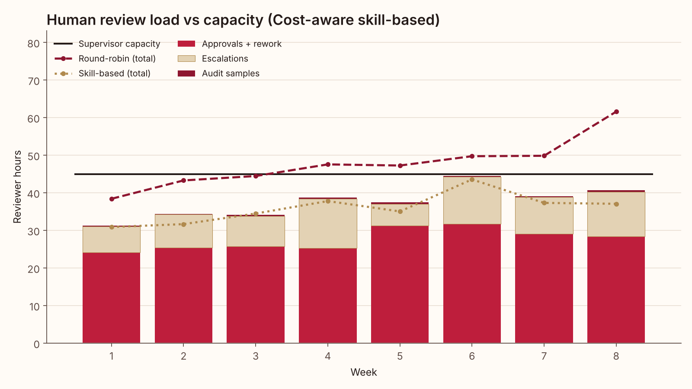
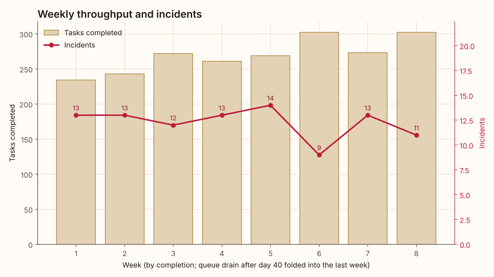

# AI Workforce Manager

**Run AI agents like a well-managed team: roles, routing, human oversight, performance reviews, cost control and governance.**

[](https://github.com/laurenbmcguire/ai-workforce-manager/actions/workflows/ci.yml)




> Portfolio project. Every agent, person, task and number here is synthetic and produced by the
> seeded generator and simulator in this repo. Nothing describes a production deployment.

## Why it matters

- **AI agents need management, not just prompts.** Once several agents share a queue, someone has to decide who does what, what needs a human sign-off, and when an agent has earned more autonomy. This repo turns those decisions into explicit, testable policy.
- **Human review is the real bottleneck and cost.** In the sample run, supervisor time is about 89% of the fully loaded cost per task, while model spend is about 11%. Routing that ignores oversight cost looks cheap and is not.
- **Governance has to be evidence-based.** Promotions, model downgrades and retirements come with the numbers that justify them, every decision lands in an audit log, and a RACI matrix makes one human accountable for every task type.

## What it does

- **Roster schema** (`examples/roster.yml`): 9 AI agents with role, skills (proficiency 0-1), model tier (small/medium/large with cost per task and latency), autonomy level 1-4 (suggest-only, draft-for-approval, act-with-audit, fully autonomous) and a human manager; 3 human supervisors with daily review capacity. Validated on load.
- **Synthetic workload**: 8 weeks, 11 task types (triage, access requests, KB articles, data-quality checks, code and security reviews, contract checks, ...) with required skills, risk level (low/medium/high/regulated), SLA hours and value. 3% weekly volume growth.
- **Policy engine**
  - three routing strategies: round-robin, skill-based and cost-aware skill-based
  - human-in-the-loop rule: autonomy below the risk threshold means human approval, which consumes supervisor capacity
  - escalation to a human when the agent's confidence is low
  - an append-only audit log of every routing, approval, escalation, audit and incident decision
- **Day-step simulation** with per-agent daily capacity, reviewer queues spread across the working day, reviewer fatigue (automation bias) and post-hoc audit sampling.
- **KPIs** per agent and overall: throughput, first-pass quality, escalation rate, human review hours, cost per task, SLA attainment, incident rate, value delivered and net value.
- **Automated performance reviews** with a rule-based recommendation per agent (increase autonomy, keep, retrain / prompt-tune, downgrade model tier, retire) and the evidence behind it.
- **Governance outputs**: a RACI matrix (humans x AI agents x task types) in Markdown, and a capacity plan for supervisor hours next month.
- **AI Project Manager** that reads the roadmap, risk register and pipeline results and writes a weekly status report (optional LLM narrative).

## Architecture



## Results on the sample data

2,156 synthetic tasks over 8 weeks (40 business days), 9 agents, 3 supervisors with 9 review hours/day between them. All three strategies run on the same task stream and the same random draws, so the differences come from routing alone.

| Strategy | Cost / task | First-pass quality | SLA attainment | Escalation rate | Review hours | Incidents | Net value | Reviewer utilization |
|---|---|---|---|---|---|---|---|---|
| Round-robin | $16.98 | 73.7% | 84.8% | 13.3% | 382 | 146 | $15,978 | 101.1% |
| Skill-based | $12.68 | 86.7% | 100.0% | 3.7% | 288 | 111 | $32,488 | 78.0% |
| **Cost-aware skill-based** | $13.28 | 84.9% | 98.7% | 4.5% | 300 | **98** | **$34,564** | 81.3% |

What the run shows:

- **Round-robin overloads the reviewers.** Rotating work to agents regardless of skill pushes the escalation rate to 13.3% and review demand past capacity (101%), so SLA attainment drops to 84.8%.
- **Cost-aware routing is the deployed strategy.** It spends $0.60 more per task than pure skill-based routing because it prices oversight and expected incident cost into each decision, and in return has 12% fewer incidents (98 vs 111) and the highest net value ($34,564 vs $32,488).
- **Performance reviews** (cost-aware run): Sentinel -> *increase autonomy* (91.6% first-pass quality on the medium-risk work L3 would release, ~4.1 reviewer h/week freed); Vega -> *downgrade model tier* (estimated -2.9 pts quality, $860 saved over 8 weeks); Ledger and Scout -> *retrain / prompt-tune* (Ledger: 42.1% first-pass quality on contract checks, 33.3% escalation); Mercury -> *retire* (0 tasks routed, fully redundant); 4 agents *keep*.
- **Capacity plan:** next month needs **204 supervisor hours vs 180 available** (113% with a 15% buffer); applying the autonomy recommendation brings it to 185 h. Marcus Hale's queue is the tightest (130%).
- **Audit:** 5,623 decisions logged for the deployed strategy; 11 audit samples were skipped for lack of reviewer capacity (an audit gap the AI PM flags).

<p>


</p>



Full output: [reports/workforce_report.md](reports/workforce_report.md) (strategy table, agent KPIs, reviews with evidence, RACI matrix, capacity plan, audit summary) and [reports/summary.json](reports/summary.json).

## AI Project Manager

`python -m aiworkforce pm` runs an AI PM that manages this repo as a project. It reads
`project/ROADMAP.yml` (milestones and backlog), `project/RISKS.yml` and the pipeline's
`reports/summary.json`, then writes [project/STATUS.md](project/STATUS.md) and `project/status.json`.

The deterministic engine always runs (and is what the tests target):

- **Health RAG** with explicit rules: RED for an overdue milestone, a risk score >= 20 or two or more open P0 items; AMBER for an open P0 or a risk score >= 15; GREEN otherwise.
- **Milestone table** with % done (share of linked backlog items done).
- **Risk register** sorted by score (probability x impact) with a heat label.
- **Next 3 actions**: unblocked `todo` items ranked by priority, then by dependencies satisfied.
- **What the data says**: 3-5 bullets taken from `reports/summary.json`.
- **Decision / change log** entry.

Abridged excerpt from the committed `project/STATUS.md`:

```text
Health: AMBER - 1 risk(s) scored >= 15 (R1); no milestone is overdue

Next 3 actions
| 1 | B10 | AgentAdapter interface (simulated and live agents) | P1 | Lauren | B05 |
| 2 | B13 | Model cost drift monitor per tier                  | P1 | AI PM  | B07 |
| 3 | B12 | Confidence calibration study for the escalation... | P2 | AI PM  | B06 |

What the data says
- Cost-aware skill-based routing has the highest net value ($34,564) vs round-robin ($15,978):
  first-pass quality 84.9% vs 73.7%, incidents 98 vs 146.
- Next month needs 204 supervisor hours vs 180 available (113%); 185 h if autonomy
  recommendations are applied.
- Audit gap: 11 post-hoc audit samples were skipped for lack of reviewer capacity.
```

**LLM mode.** If `ANTHROPIC_API_KEY` is set, the PM sends the computed facts JSON to the Anthropic
Messages API (standard-library `urllib`, model from `AI_PM_MODEL`, default `claude-sonnet-4-5`) and
asks for a 90-120 word executive summary grounded only in those facts. With no key, or on any error,
it falls back to a deterministic template, so the run never fails because of the LLM. Tests mock the
HTTP call and never touch the network.

**Automation.** `.github/workflows/ai-pm.yml` runs every Monday (13:17 UTC) and on demand: it runs the
pipeline and the PM, appends STATUS.md to the job summary and commits the refreshed status, charts and
reports as `github-actions[bot]`. Add an `ANTHROPIC_API_KEY` repository secret to enable the LLM summary.

## Quickstart

```bash
git clone https://github.com/laurenbmcguire/ai-workforce-manager.git
cd ai-workforce-manager
pip install -e .
python -m aiworkforce run      # simulate, write charts to docs/img and reports to reports/
python -m aiworkforce pm       # AI PM: write project/STATUS.md
pip install pytest && pytest -q
```

The full pipeline runs offline in about 2 seconds.

## Project structure

```text
ai-workforce-manager/
├── examples/
│   ├── roster.yml            # agents, model tiers, supervisors, oversight policy
│   ├── workload.yml          # task types, volume and growth
│   └── tasks.csv             # generated 8-week task stream (seeded)
├── src/aiworkforce/
│   ├── roster.py             # schema, validation, HITL approval rule
│   ├── workload.py           # seeded task generator
│   ├── policy.py             # routers, success model, escalation, audit log
│   ├── simulation.py         # day-step simulation with reviewer queues
│   ├── kpis.py               # agent, fleet and weekly KPIs
│   ├── reviews.py            # rule-based performance reviews with evidence
│   ├── governance.py         # RACI matrix and capacity plan
│   ├── charts.py, style.py   # matplotlib charts in the brand style
│   ├── report.py, pipeline.py, cli.py, __main__.py
│   └── ai_pm.py              # AI Project Manager
├── tests/                    # 31 pytest tests
├── docs/img/                 # charts produced by the pipeline
├── reports/                  # workforce_report.md, summary.json, RACI, KPIs, audit sample
├── project/                  # ROADMAP.yml, RISKS.yml, STATUS.md, status.json
└── .github/workflows/        # ci.yml, ai-pm.yml
```

## Methodology

**Proficiency.** For a task with required skills $S$, an agent's proficiency is $\bar p = \frac{1}{|S|}\sum_{s \in S} p_s$. Only agents holding every required skill are eligible.

**Success model.** The agent's output is correct with probability
$P = \sigma\big(k(\bar p + b_{tier} - d)\big)$, with $\sigma$ the logistic function, $k = 7$, tier bonus $b_{tier}$ (small -0.04, medium 0, large +0.05) and per-task difficulty $d$.
The agent reports confidence $c = \mathrm{clip}(P + \varepsilon, 0, 1)$ with $\varepsilon \sim N(0, 0.12)$.

**Routing.**
- Round-robin: rotate through eligible agents per task type.
- Skill-based: highest $\bar p$ among agents with spare daily capacity (ties go to the lighter load).
- Cost-aware: maximise $\text{score} = \bar p \cdot V - \text{cost} - \lambda \cdot \frac{\text{load}}{\text{capacity}}$, where
  $\text{cost} = c_{model} + \mathbb{1}[\text{approval}]\cdot \frac{m_{review}}{60} w + (1-\hat P)\,(1-q)^{\mathbb{1}[\text{approval}]}\,C_{risk}$:
  model cost, expected reviewer cost at hourly rate $w$, and expected incident cost ($\hat P$ = success model at the task type's catalog difficulty, $q$ = review catch rate, $C_{risk}$ = incident cost for the risk level), with $\lambda = \$8$.

**Human-in-the-loop.** Approval is required when the agent's autonomy is below the policy threshold for the task's risk: low 3, medium 3, high 4, regulated 5 (so regulated work is always signed off). Confidence below 0.55 escalates the task to a human, who resolves it with 97% accuracy. Reviewers catch 85% of errors, 65% once they have used more than 85% of their daily review hours (fatigue / automation bias). Caught errors are reworked (half the human task effort); uncaught errors, and errors from agents acting on their own, become incidents. 10% of act-with-audit (L3) work is sampled for a 3-minute post-hoc audit if capacity remains that day.

**Time and SLA.** Review hours are spread across an 8-hour day, so a supervisor with $h$ review hours spends $8/h$ wall-clock minutes per review minute. Work not reached today carries over. A task meets its SLA if completion time minus arrival time is within its SLA hours.

**KPIs.** First-pass quality = share of an agent's tasks whose own output was correct and was not escalated. Cost per task = (model cost + reviewer hours x $85) / tasks completed. Value delivered = task value if correct (50% if the SLA was missed). Net value = value delivered - model cost - reviewer cost - incident cost (low $40, medium $150, high $600, regulated $2,500). The deployed strategy is the one with the highest net value.

**Performance reviews** (first rule that fires): retire if utilisation < 5% and every task type it can take has another eligible agent; retrain if first-pass quality < 75%, escalation > 12% or incident rate > 8%; downgrade if quality >= 85% and the cheaper tier is estimated to lose <= 3 points; increase autonomy if, on exactly the work one more level would release from review, quality >= 90% and escalation <= 5%, the overall incident rate is <= 3% and >= 5 reviewer hours are freed; otherwise keep.

**Capacity plan.** A linear trend on daily arrivals is extrapolated over the next 20 business days, multiplied by the observed human minutes per task, plus a 15% buffer, and split by each supervisor's observed share of review work.

**Common random numbers.** Every task's random draws (success, confidence noise, catch, audit, human outcome) are generated once from a fixed seed, so strategy comparisons are paired and the run is fully deterministic.

## Data

All data is synthetic. `examples/tasks.csv` is generated by `aiworkforce.workload.generate_tasks` from `examples/workload.yml` with seed 2026, and the roster in `examples/roster.yml` (agent names, supervisors, proficiencies, costs) is invented for illustration. Costs and values are illustrative assumptions, not vendor prices or business results. The reported metrics are what this code computes on that synthetic data.

## Roadmap

From [project/ROADMAP.yml](project/ROADMAP.yml):

| ID | Milestone | Due | Status |
|---|---|---|---|
| M1 | Roster schema and synthetic workload | 2026-09-18 | done |
| M2 | Routing engine (round-robin, skill-based, cost-aware) | 2026-10-02 | done |
| M3 | Human-in-the-loop policy, escalation and audit log | 2026-10-16 | done |
| M4 | Simulation and KPIs | 2026-10-23 | done |
| M5 | Performance reviews, RACI and capacity planning | 2026-10-30 | done |
| M6 | Live LLM agent adapter | 2026-12-11 | planned |
| M7 | Workforce dashboard | 2027-01-29 | planned |

Tracked risks include automation bias, over-trusting autonomous agents, audit gaps, the simulation-to-reality gap, model cost drift and confidence miscalibration (see [project/RISKS.yml](project/RISKS.yml)).

## Author

**Lauren McGuire**, AI & Cloud Architect
[laurenmcguireresume.com](https://laurenmcguireresume.com) · [LinkedIn](https://www.linkedin.com/in/laurenbmcguire)
