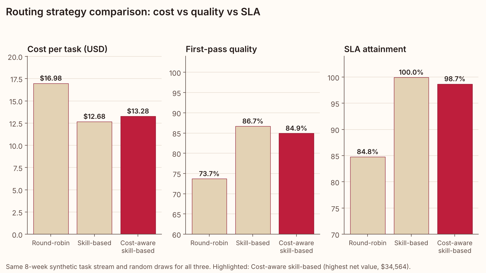
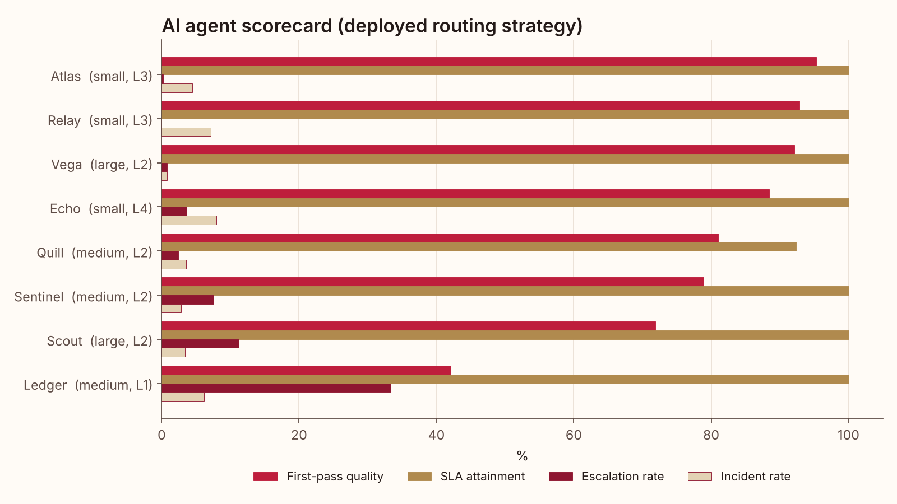
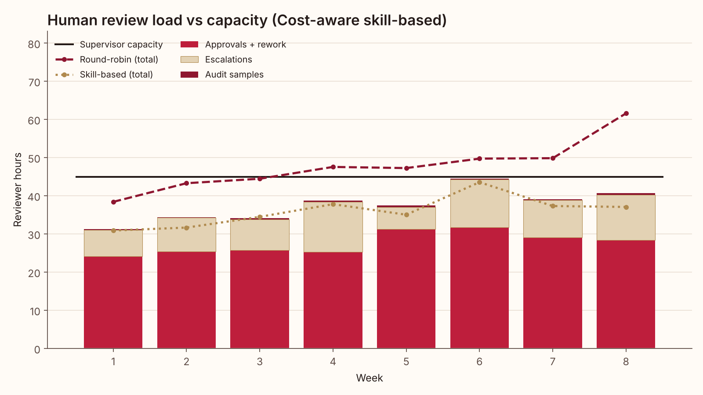
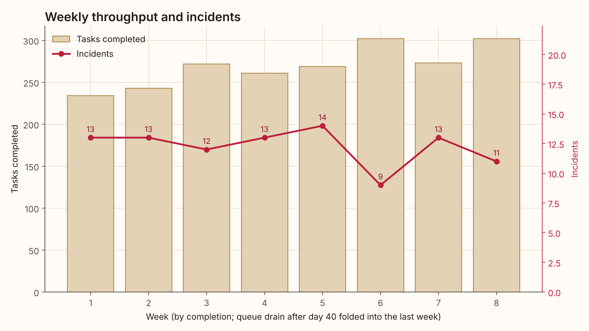

# AI Workforce Report

Generated by `python -m aiworkforce run` on **synthetic data** (seeded generator, 2,156 tasks over 8 weeks, 9 AI agents, 3 human supervisors). No real people, systems or business results are represented.

## Headline

- Deployed routing strategy: **Cost-aware skill-based** (highest net value of the three).
- First-pass quality 84.9%, SLA attainment 98.7%, incident rate 4.5%, fully loaded cost $13.28 per task.
- Human oversight: 300 reviewer hours over the period (81.3% of supervisor capacity).
- Next month needs **204 supervisor hours** vs 180 available. Short by 24 h: add 1.2 reviewer h/day or apply the autonomy recommendations.

## Routing strategy comparison

All three strategies run on the same task stream with the same random draws (common random numbers), so differences come from routing alone.

| Strategy | Cost / task | First-pass quality | SLA attainment | Escalation rate | Review hours | Incidents | Incident rate | Value delivered | Net value | Reviewer utilization |
|---|---|---|---|---|---|---|---|---|---|---|
| Round-robin | $16.98 | 73.7% | 84.8% | 13.3% | 382 | 146 | 6.8% | $90,371 | $15,978 | 101.1% |
| Skill-based | $12.68 | 86.7% | 100.0% | 3.7% | 288 | 111 | 5.1% | $97,476 | $32,488 | 78.0% |
| Cost-aware skill-based | $13.28 | 84.9% | 98.7% | 4.5% | 300 | 98 | 4.5% | $97,020 | $34,564 | 81.3% |

## Agent KPIs (Cost-aware skill-based)

| Agent | Role | Tier | Autonomy | Tasks | Tasks / week | First-pass quality | Escalation | Review h | Cost / task | SLA | Incident rate | Value delivered |
|---|---|---|---|---|---|---|---|---|---|---|---|---|
| Atlas | Service Desk Triage Agent | small | L3 | 405 | 50.6 | 95.3% | 0.2% | 1.5 | $0.66 | 100.0% | 4.4% | $7,244 |
| Quill | Knowledge Base Writer | medium | L2 | 368 | 46.0 | 81.0% | 2.5% | 42.5 | $11.22 | 92.4% | 3.5% | $12,341 |
| Sentinel | Data Quality Analyst | medium | L2 | 318 | 39.8 | 78.9% | 7.5% | 70.8 | $20.32 | 100.0% | 2.8% | $18,014 |
| Echo | Meeting Notes Agent | small | L4 | 328 | 41.0 | 88.4% | 3.7% | 9.0 | $2.68 | 100.0% | 7.9% | $7,056 |
| Vega | Code Review Agent | large | L2 | 253 | 31.6 | 92.1% | 0.8% | 68.0 | $27.64 | 100.0% | 0.8% | $21,506 |
| Ledger | Procurement Assistant | medium | L1 | 114 | 14.2 | 42.1% | 33.3% | 78.5 | $59.93 | 100.0% | 6.1% | $16,220 |
| Relay | Access Request Agent | small | L3 | 281 | 35.1 | 92.9% | 0.0% | 1.0 | $0.67 | 100.0% | 7.1% | $6,764 |
| Mercury | Email Drafting Agent (legacy pilot) | small | L3 | 0 | 0.0 | 0.0% | 0.0% | 0.0 | $0.00 | 0.0% | 0.0% | $0 |
| Scout | Research Generalist Agent | large | L2 | 89 | 11.1 | 71.9% | 11.2% | 28.8 | $32.34 | 100.0% | 3.4% | $7,875 |

## Performance reviews

| Agent | Recommendation | Evidence |
|---|---|---|
| Atlas | **keep** | FPQ 95.3%, escalation 0.2%, incidents 4.4%, SLA 100.0%; L4 would not remove any approvals for its current work |
| Quill | **keep** | FPQ 81.0%, escalation 2.5%, incidents 3.5%, SLA 92.4%; L3 would free 42.5 h, but FPQ on that work is 81.0% |
| Sentinel | **increase autonomy** | L2 -> L3 would remove approval for medium-risk work (215 tasks); first-pass quality on that work 91.6%, escalation 0.9%; overall incident rate 2.8%; frees ~32.9 reviewer hours over 8 weeks (4.1 h/week) |
| Echo | **keep** | FPQ 88.4%, escalation 3.7%, incidents 7.9%, SLA 100.0% |
| Vega | **downgrade model tier** | first-pass quality 92.1% on large; estimated quality change on medium: -2.9 pts (limit -3 pts); model spend saving $860 over 8 weeks ($4.80 -> $1.40 per task) |
| Ledger | **retrain / prompt-tune** | first-pass quality 42.1% < 75.0%; escalation rate 33.3% > 12.0%; weakest task type: contract_check (FPQ 42.1%, n=114); incident cost $17,500; net value -$8,112 |
| Relay | **keep** | FPQ 92.9%, escalation 0.0%, incidents 7.1%, SLA 100.0%; L4 would not remove any approvals for its current work |
| Mercury | **retire** | utilization 0.0% < 5.0%; handled 0 of 2156 tasks; every task type it can take (customer_reply) has another eligible agent |
| Scout | **retrain / prompt-tune** | first-pass quality 71.9% < 75.0%; weakest task type: vendor_comparison (FPQ 72.7%, n=88); incident cost $450; net value $4,547 |

## RACI matrix (humans x AI agents x task types)

| task_type | risk | Priya Raman | Marcus Hale | Elena Ortiz | Atlas | Quill | Sentinel | Echo | Vega | Ledger | Relay | Mercury | Scout |
|---|---|---|---|---|---|---|---|---|---|---|---|---|---|
| incident_triage | low | A | I | I | R | - | - | - | - | - | C | - | - |
| access_request | medium | A | I | I | C | - | - | - | - | - | R | - | - |
| customer_reply | medium | A | I | I | C | R | - | - | - | - | - | C | - |
| meeting_summary | low | A | I | I | - | C | - | R | - | - | - | - | C |
| kb_article | low | A | I | I | - | R | - | R | - | - | - | - | C |
| data_quality_check | medium | I | A | I | - | - | R | - | - | - | - | - | C |
| anomaly_report | high | I | A | C | - | - | R | - | - | - | - | - | C |
| code_review | high | I | A | C | - | - | - | - | R | - | - | - | C |
| security_review | regulated | I | C | A | - | - | - | - | R | - | - | - | C |
| vendor_comparison | medium | I | A | I | - | - | - | - | - | C | - | - | R |
| contract_check | regulated | I | I | A | - | - | - | - | - | R | - | - | C |

R = Responsible (does the work), A = Accountable (signs off, owns the outcome), C = Consulted (backup agent or co-owner), I = Informed, - = not involved.

## Capacity plan: supervisor hours next month

- Volume trend: +0.326 tasks/day per day; forecast 1,274 tasks over the next 20 business days (63.7 per day).
- Observed human effort: 8.35 min per task (approvals, rework, escalations, audit samples), plus a 15% buffer.
- Hours needed: **203.9**; available: 180.0 (113.3% planned utilization).
- If the autonomy recommendations are applied: 185.0 h.

| Supervisor | Hours needed | Hours available | Utilization |
|---|---|---|---|
| Priya Raman | 56.7 | 60.0 | 94.5% |
| Marcus Hale | 91.0 | 70.0 | 130.0% |
| Elena Ortiz | 56.1 | 50.0 | 112.3% |

## Weekly throughput and incidents

## Audit log

Every routing, oversight and outcome decision is logged (5,623 events for the deployed strategy). Full log: `reports/audit_log.csv` (regenerated, not committed); first 200 events: `reports/audit_log_sample.csv`.

| Event | Count |
|---|---|
| audit_sample | 47 |
| audit_skipped | 11 |
| auto_execute | 1,001 |
| escalate | 96 |
| hitl_hold | 1,059 |
| human_resolve | 96 |
| incident | 98 |
| review_approve | 923 |
| review_reject | 136 |
| route | 2,156 |
